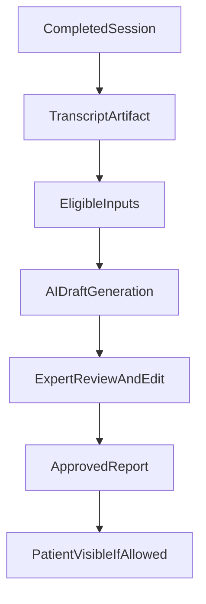

# Eleva.care v3 AI And Reporting Spec

Status: Authoritative

## Purpose

This document defines how AI-assisted workflows and reporting should work in Eleva.care v3.

It should guide:

- transcript handling
- AI-assisted report generation
- prompt and review architecture
- expert workflow design
- consent and audit boundaries

## Product Goals

AI in Eleva should help experts save time and improve workflow quality.

It should not:

- replace expert judgment
- silently publish clinical or customer-facing reports without review
- bypass privacy and consent boundaries

The main AI use cases are:

- transcript summarization
- draft report generation
- structured note extraction
- listing the follow-ups an expert noted
- customer-facing summary drafting where explicitly allowed

## AI Principles

- Human-in-the-loop by default.
- AI output is a draft until an expert or authorized operator approves it.
- Prompt and model usage should be observable and auditable.
- Sensitive data handling must be explicit.
- AI should be tied to clear product jobs, not added as vague magic.

## Intended purpose per feature

Eleva's AI features help an expert write. They do not assess a member, and they give no
information for a diagnostic or therapeutic decision. Each feature has one stated purpose,
and the product and its copy stay inside it.

**Status: proposed, pending device counsel.** Whether a feature is medical-device software
under Regulation (EU) 2017/745 depends on its function and on what Eleva says about it, not
on a disclaimer. Counsel confirms this table before `ff.ai_reports_beta` is switched on.

| Feature                 | Status               | Intended purpose                                                                              |
| ----------------------- | -------------------- | --------------------------------------------------------------------------------------------- |
| Editor assist           | Built                | Helps an expert word and translate their own public profile text                              |
| Live transcription      | Built, consent-gated | Turns what is said in a video session into text for the expert's written record               |
| Session-report draft    | Built, flag off      | Reorganises the expert's own notes into a draft the expert edits; it adds no clinical content |
| Summary from transcript | Specified            | Summarises what was said, for the expert to correct                                           |
| Member-facing summary   | Specified            | Restates the expert's approved report in plain words                                          |
| Follow-ups noted        | Specified            | Lists follow-ups the expert already wrote down                                                |
| Structured extraction   | Specified            | Pulls out action items and themes the expert wrote                                            |

Rules that keep each feature inside its purpose:

- **Extractive output.** A draft restates the input. The prompt contract has no field for
  model-originated advice, warnings or risk flags (`packages/ai/src/prompts/session-report.v2.ts`;
  a test fails if one is added).
- **Copy.** Never say that Eleva's AI "detects", "recommends", "assesses", "flags" or gives
  "clinical insights". Say that it drafts, organises, summarises or translates what the
  expert wrote or said.
- **The expert decides.** No draft reaches a member until the expert has edited, saved and
  published it as their own report.
- **New feature, new row.** A feature that would infer anything about a member's health
  (symptom tracking, triage, risk scoring, suggested treatment) is not added to this table
  without a device-qualification decision first.

## Primary Inputs

AI-assisted reporting may use:

- session transcripts
- expert notes
- booking/session metadata
- shared diary data where consent allows
- structured templates and report schemas

## Core AI Outputs

### Draft session report

Represents a report draft generated from approved inputs.

### Draft summary for patient/customer

Represents a customer-facing summary that still requires review if policy demands it.

### Follow-ups the expert noted

Lists the follow-ups the expert already wrote in their notes, so they are easy to act on.
The model does not propose follow-up topics, reminder timing or a next appointment of its
own.

### Structured extraction

Examples:

- action items the expert wrote down
- themes

Symptom tracking and any model-inferred clinical field are out of scope (see "Intended
purpose per feature").

## Workflow Model

Recommended pipeline:

1. session happens
2. transcript becomes available
3. eligible inputs are assembled
4. AI draft is generated
5. expert reviews and edits
6. approved report becomes visible to patient/customer where appropriate

## Role Of Daily

Daily should be treated as the video and transcript source, not the final home of Eleva reporting logic.

Eleva should own:

- report lifecycle
- transcript intake pipeline
- prompt contracts
- output storage rules
- review/approval workflow

## Role Of Vercel AI Gateway

**Locked decision** (ADR-009): **Vercel AI Gateway is the exclusive model router** for Eleva AI pipelines. `packages/ai` owns all gateway interactions, prompt contracts, and pipeline definitions.

CI rule: no direct LLM provider SDKs (OpenAI, Anthropic, Mistral, etc.) outside `packages/ai`.

Responsibilities:

- model routing with provider fallback
- cost tracking per prompt contract (surfaced in admin dashboard per expert/clinic for AI credit attribution)
- observability via Sentry tags + BetterStack logs (with redaction)
- prompt contract versioning

Eleva defines stable internal prompt/output contracts — ad hoc calls are banned.

## Prompt Contracts

The system should define prompt classes for:

- session-summary draft
- patient-facing summary draft
- expert follow-up suggestion draft
- structured extraction

Each prompt class should have:

- allowed inputs
- output schema
- visibility policy
- reviewer expectations

## Output Review Model

Default rule:

- AI output is not final until reviewed when it affects expert or patient records

This should be especially strict for:

- patient-visible reports
- clinically meaningful summaries
- sensitive structured extraction

## Visibility And Consent

The AI system must respect:

- transcript consent
- diary-data sharing consent
- patient visibility rules
- organization context
- expert permissions

If an input is not authorized for a given context, it must not be included in the generation pipeline.

## Audit Requirements

The system should log:

- which generation type ran
- what authorized inputs were used at a metadata level
- who triggered it
- who reviewed it
- whether the output became patient-visible

Do not log raw sensitive content unnecessarily in general-purpose logs.

## Storage Model

The system should distinguish between:

- transcript artifact
- AI draft
- reviewed/approved report
- final patient-visible report

These are different states and should not be collapsed into one generic text blob.

## Initial Scope

The first build should support:

- transcript ingestion
- one or two high-value draft generation flows
- expert review/edit
- approved report visibility

## Deferred Scope

Later phases may add:

- richer template libraries
- multiple report types per session
- more advanced extraction pipelines
- organization-level reporting analytics

## Retention (Locked Defaults — ADR-009)

- transcripts — 2 years from session
- AI drafts (unpublished) — 90 days
- published reports — 10 years (ERS-aligned)

All subject to accountant + legal review before GA.

## Workflow Integration

The AI pipeline runs as Vercel Workflow DevKit step graphs (ADR-007):

- `transcriptReady` — Daily transcript webhook (`POST /webhooks/daily`) → `withAudit` store Eleva record (encrypted via `@eleva/encryption`, ADR-020) + enqueue draft in the same transaction
- `aiReportDraft` — call Vercel AI Gateway → persist draft as `report.status = 'draft'` → notify expert for review (Lane 1 `report_available_for_review` notification)
- `aiReportPublication` — expert approves → `report.status = 'published'` → `report_available` Lane 1 notification with secure signed link

Feature flag: `ff.ai_reports_beta` for staged rollout.

## Closed Decisions

- Vercel AI Gateway is the sole model router (ADR-009)
- No direct LLM provider SDKs outside `packages/ai`
- Transcripts are Eleva-owned records encrypted via `@eleva/encryption` (ADR-020).
- Human-in-the-loop is mandatory for any patient-visible report

## Open Questions

- which exact report types launch first (probably "session summary" + "follow-up suggestions")
- whether customer-facing summaries require separate consent beyond session consent
- whether some session types should disable AI by default (e.g., high-sensitivity categories)

## Related Docs

- [`mobile-integration-spec.md`](./mobile-integration-spec.md)
- [`crm-spec.md`](./crm-spec.md)
- [`compliance-data-governance.md`](./compliance-data-governance.md)
- [`ops-observability-spec.md`](./ops-observability-spec.md)
- [`workflow-orchestration-spec.md`](./workflow-orchestration-spec.md)
- [`notifications-spec.md`](./notifications-spec.md)
- [`feature-flag-rollout-plan.md`](./feature-flag-rollout-plan.md)
- [`adrs/README.md`](./adrs/README.md) (ADR-009 AI & Transcripts)
